# CNN Image Classifier

A convolutional neural network (CNN) that classifies CIFAR-10 images, built as a
robot-vision component for the **Applied Robotics and AI Project**
(BEng (Hons) Robotics and Artificial Intelligence, University of Hertfordshire, PSB Academy).

- **Trello board:** https://trello.com/b/MbC8PuMr/applied-robotics-ai-project-task-management-for-cnn-image-classifier
- **GitHub repository:** https://github.com/Seenivasan731/cnn-image-classifier

## Contents
1. [Project Description](#project-description)
2. [Repository Structure](#repository-structure)
3. [Setup](#setup)
4. [Running the Application](#running-the-application)
5. [Workflow](#workflow)
6. [Branching Strategy](#branching-strategy)
7. [Commit Messages](#commit-messages)
8. [Key Git Commands](#key-git-commands)
9. [Screenshots and Explanations](#screenshots-and-explanations)
10. [Add vs Commit vs Push](#add-vs-commit-vs-push)
11. [Pull Request History](#pull-request-history)
12. [Project Management (Trello)](#project-management-trello)
13. [Sprint 0 Retrospective](#sprint-0-retrospective)
14. [Future Work](#future-work)
15. [Author](#author)

## Project Description
- **Goal:** classify 32x32 colour images into 10 classes using a CNN built in PyTorch.
- **Dataset:** CIFAR-10.
- **Stages:** load data, preprocess, train a baseline CNN, evaluate (accuracy and
  confusion matrix), predict on own photos, improve with data augmentation.
- **Tools:** Python, PyTorch, torchvision, NumPy, Matplotlib, scikit-learn, Gradio, Git, GitHub, Trello.

## Repository Structure
```
cnn-image-classifier/
├── README.md
├── requirements.txt
├── .gitignore
├── docs/          project plan, Add/Commit/Push document, screenshots
├── src/           source code
│   ├── load_data.py       dataset download and loader
│   ├── preprocess.py      normalization & data augmentation
│   ├── train.py           baseline CNN architecture & training loop
│   ├── evaluate.py        model evaluation & confusion matrix
│   └── app.py             Gradio web interface for custom photo predictions
├── models/        small trained weights only (*.pth ignored by Git)
└── data/          dataset (ignored by Git)
```

## Setup
```bash
git clone https://github.com/Seenivasan731/cnn-image-classifier.git
cd cnn-image-classifier
python -m venv .venv               # use "py -m venv .venv" if python is not found on Windows
source .venv/Scripts/activate      # Git Bash on Windows (or .venv\Scripts\activate on PowerShell)
pip install -r requirements.txt
python -c "import torch, torchvision, numpy, matplotlib, sklearn, gradio; print('All imports OK')"
```
Tested with Python 3.13.5 and PyTorch 2.14.1 (CPU). The virtual environment `.venv` is
ignored by Git.

## Running the Application

### 1. Launch the Web Application (Custom Photo Prediction)
The interactive Gradio web application allows users to upload any photo (JPG, PNG),
which is automatically converted to RGB, resized to 32×32 pixels, normalized, and
classified by the CNN model into the 10 CIFAR-10 categories with confidence scores.

To run the web app from the terminal:
```bash
# Ensure virtual environment is activated
source .venv/Scripts/activate      # Git Bash on Windows
# or: .venv\Scripts\activate       # PowerShell / Command Prompt

# Start the Gradio web server
python src/app.py
```
By default, the server runs locally on **`http://127.0.0.1:7860`**. Open that address in your web browser.

**Optional CLI Arguments:**
- **Custom Port:** `python src/app.py --port 8080`
- **Custom Checkpoint:** `python src/app.py --model-path models/baseline_cnn.pth`
- **Public Share Link:** `python src/app.py --share`
- **Non-Interactive Test Mode:** `python src/app.py --test-only` (validates inference pipeline without starting the web server)

### 2. Training the CNN Model
Train the CNN architecture on CIFAR-10. Training automatically includes data augmentation
(RandomCrop and RandomHorizontalFlip) for better generalization:
```bash
python src/train.py --epochs 5 --batch-size 64
```
To train without data augmentation:
```bash
python src/train.py --no-augmentation
```

### 3. Evaluating the Model
Evaluate classification accuracy on the test set and display a confusion matrix:
```bash
python src/evaluate.py --save-matrix docs/screenshots/confusion-matrix.png
```
To run an interactive confusion matrix window:
```bash
python src/evaluate.py --show
```

## Workflow
**Trello card -> branch -> commits -> Pull Request -> merge to `main` -> card to Done**

1. Move the card from To Do to In Progress (WIP limit: 3).
2. Create one branch for that card.
3. Make small commits with clear messages.
4. Open a Pull Request and merge it into `main`.
5. Attach the PR link to the card, tick its checklist and move it to Done.
6. Pull `main` locally so it stays in sync with GitHub.

## Branching Strategy
| Branch | Purpose |
|---|---|
| `main` | Stable code only; changed only through Pull Requests |
| `feature/<name>` | New functionality, e.g. `feature/environment` |
| `docs/<name>` | Documentation, e.g. `docs/readme-full` |
| `fix/<name>` | Bug fixes |

One card = one branch = one Pull Request. Branches are deleted after merging.

## Commit Messages
Start with a verb (Add, Fix, Update) and keep the message under 50 characters,
for example `Add Python requirements file`. Each commit contains one logical change.

## Key Git Commands
| Command | Purpose |
|---|---|
| `git clone <url>` | Copy a remote repository to the local machine |
| `git checkout -b <name>` | Create and switch to a new branch |
| `git status` | Show changed and staged files |
| `git add <file>` | Stage changes for the next commit |
| `git commit -m "msg"` | Save staged changes to the local repository |
| `git push -u origin <name>` | Upload a branch to the remote repository (GitHub) |
| `git pull` | Download and merge remote changes |
| `git log --oneline` | Show commit history |

## Screenshots and Explanations

### A. Environment setup (Git commands in practice)

**1. Python launcher.** `python` was blocked by the Windows Store alias, so the `py`
launcher (Python 3.13.5) was used instead.

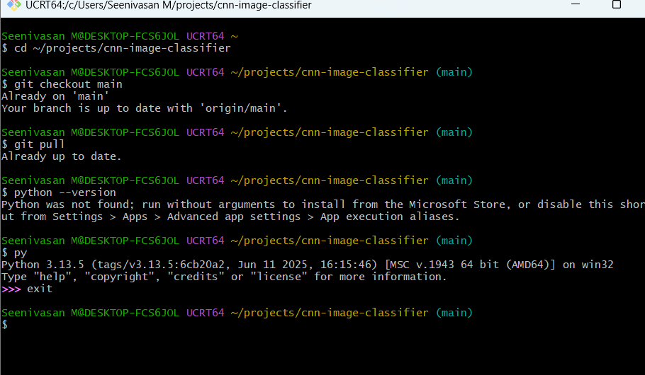

**2. Branch and virtual environment.** `git checkout -b feature/environment` created
the branch; the virtual environment `.venv` was then created and activated.

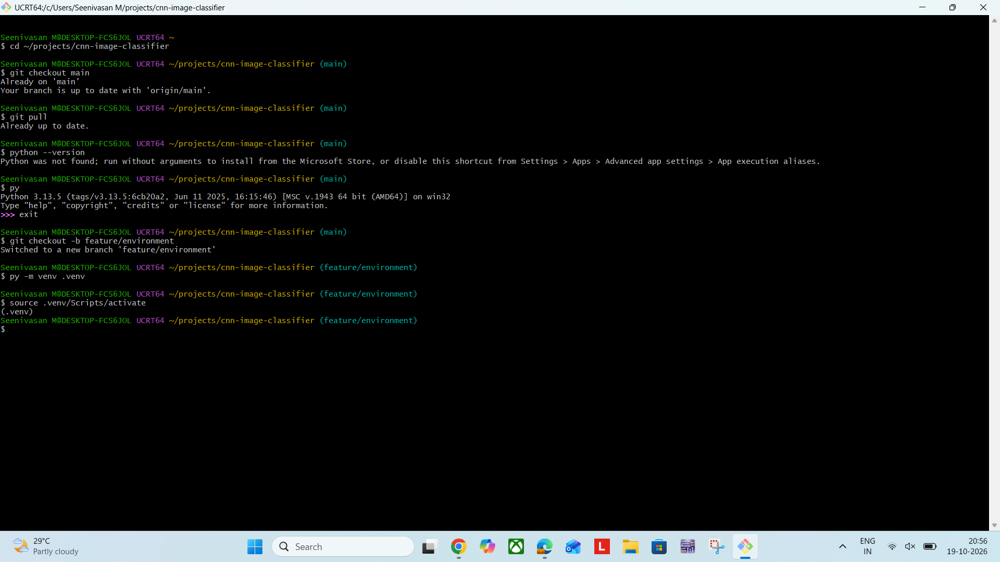

**3. Installing requirements.** `requirements.txt` was written and installed with
`pip install -r requirements.txt`.

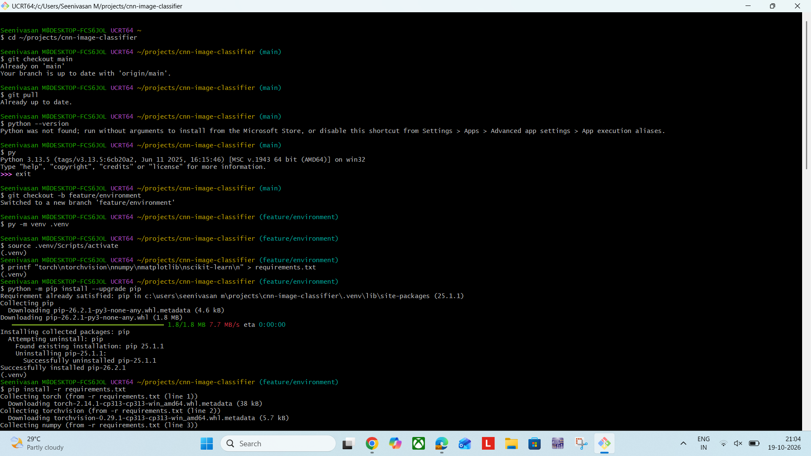
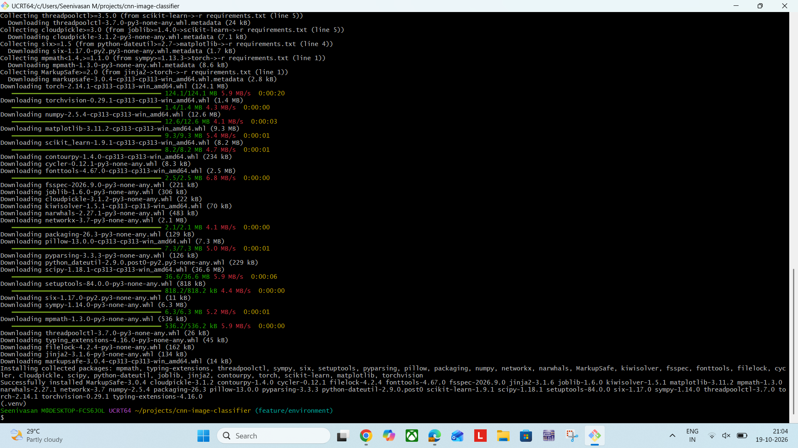

**4. Verifying the environment.** A one-line Python test imports every library and prints
the PyTorch version.

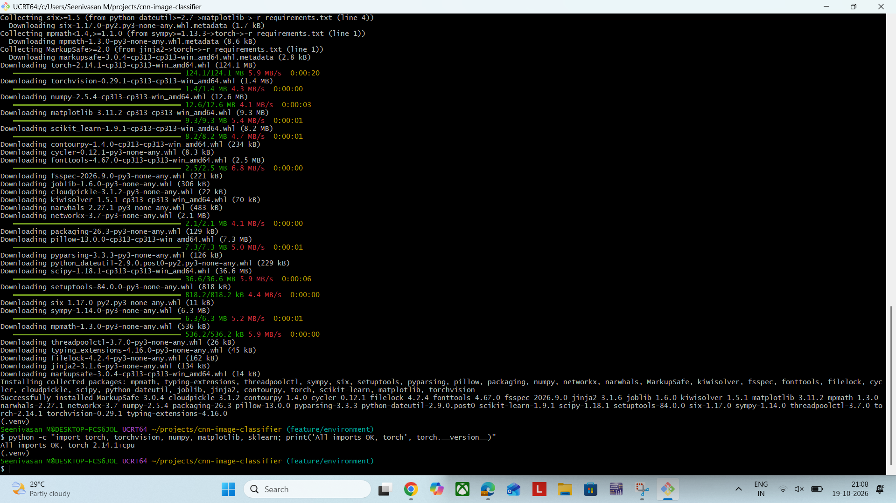

**5. Status before add.** `git status` lists only `requirements.txt` as untracked;
`.venv` is ignored.

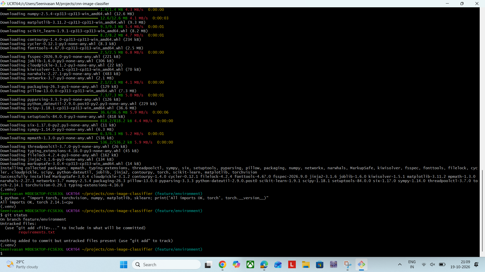

**6. Add, commit and push.** `git add` stages the file, `git commit` saves it to the
local repository, and `git push -u origin feature/environment` uploads the branch to GitHub.


**7. Pull Request.** PR #3 was opened from `feature/environment` into `main` and then merged.

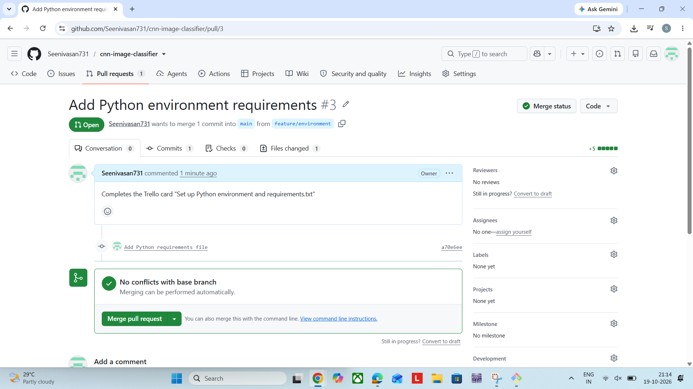
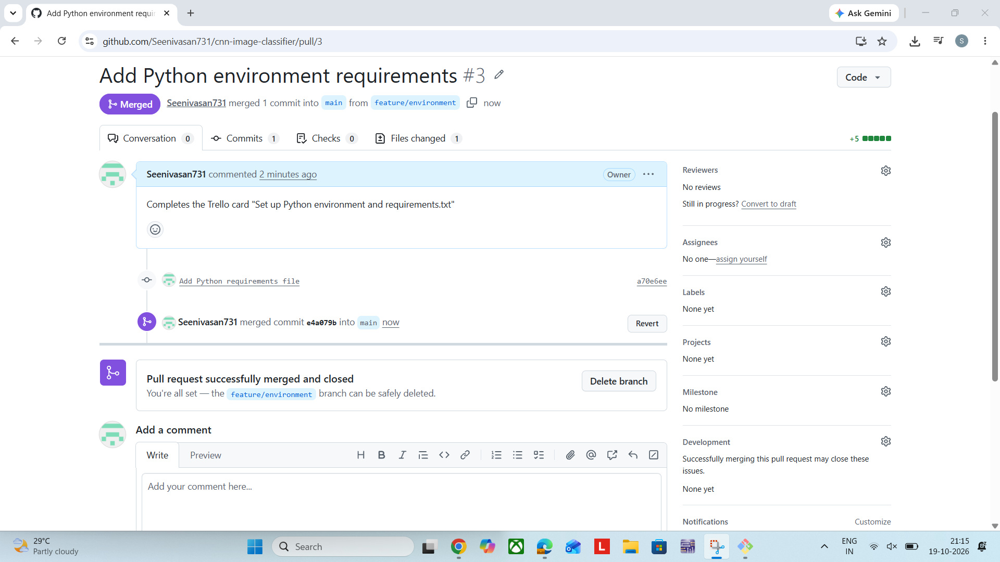

**8. Syncing `main`.** `git pull` on `main` brings the merged commit into the local repository.

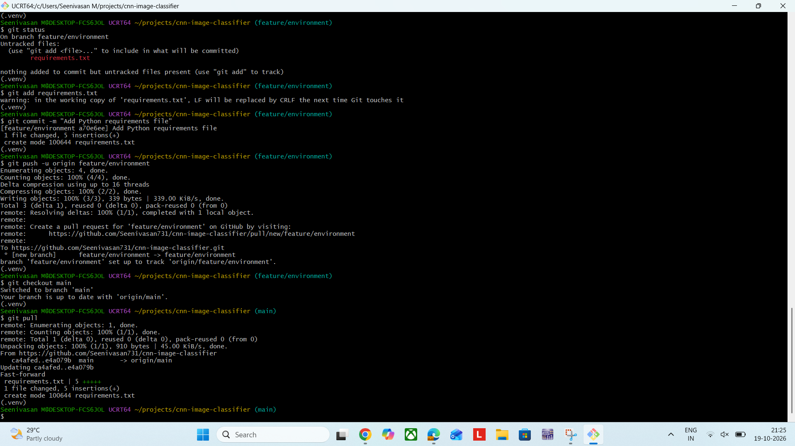

### B. Repository evidence

**9. Public repository.** The repository is public and contains the README, `.gitignore`,
`docs/` and `requirements.txt`.

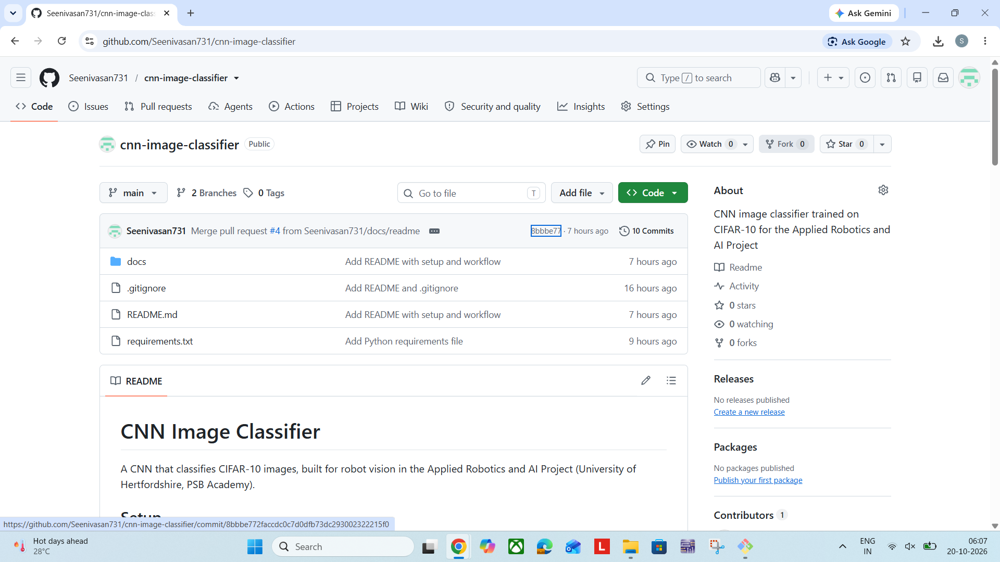

**10. Lecturer access.** The lecturer is invited as a collaborator (Settings > Collaborators).

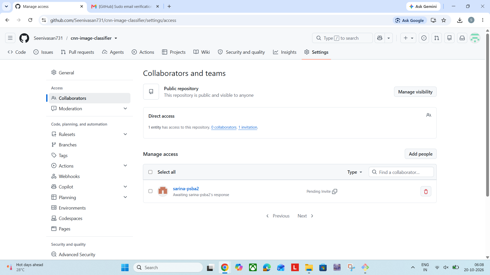

**11. Commit history.** Regular commits with meaningful messages.

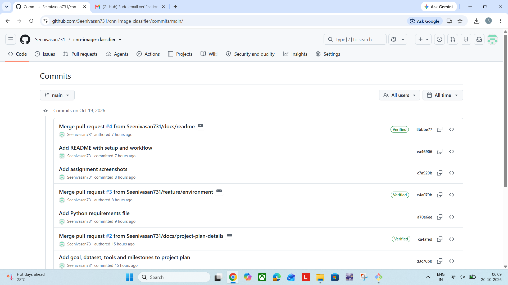

**12. Merged Pull Requests.** Every change reached `main` through a Pull Request.

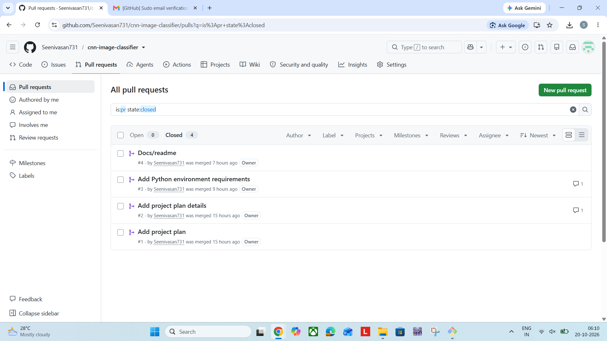

### C. Project management evidence (Trello)

**13. Board overview.** Lists Backlog, To Do, In Progress (WIP limit 3), Review and Done;
colour-coded labels, due dates and checklists.

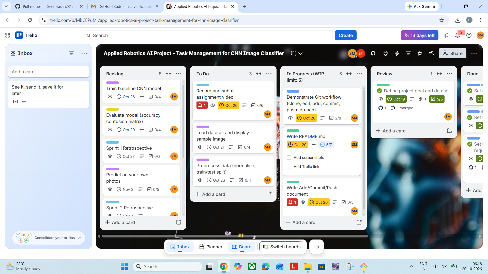

**14. Lecturer on the board.** The lecturer is a member of the Trello board.

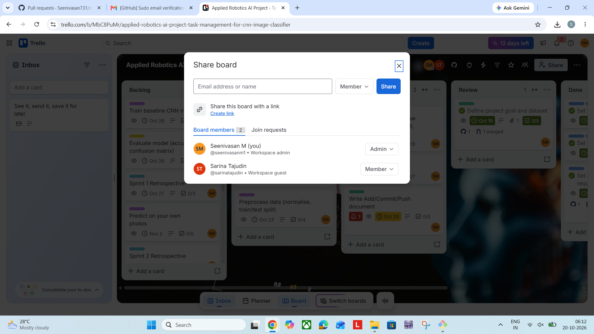

**15. Done card with PR link.** A completed card showing its label, due date, ticked
checklist and the attached Pull Request.

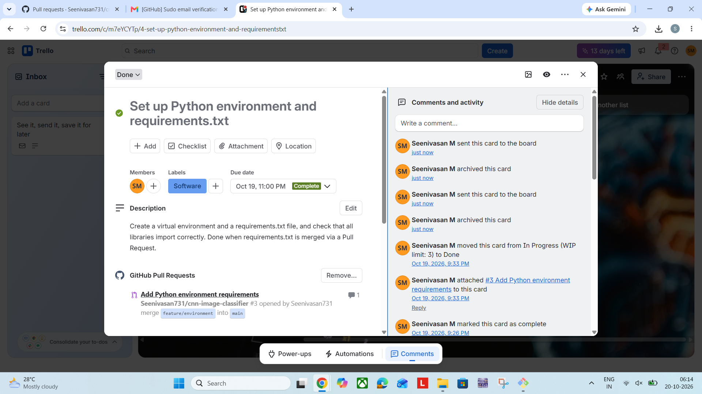

**16. Planning.** The Backlog holds all planned work up to 10 Nov 2026.

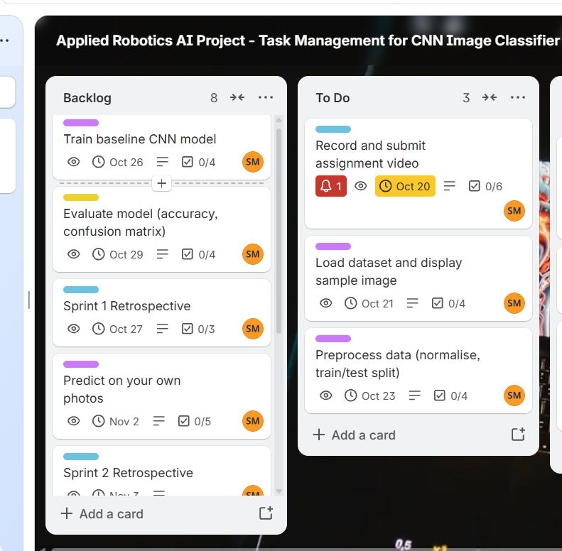

**17. Retrospective.** The Sprint 0 retrospective card.

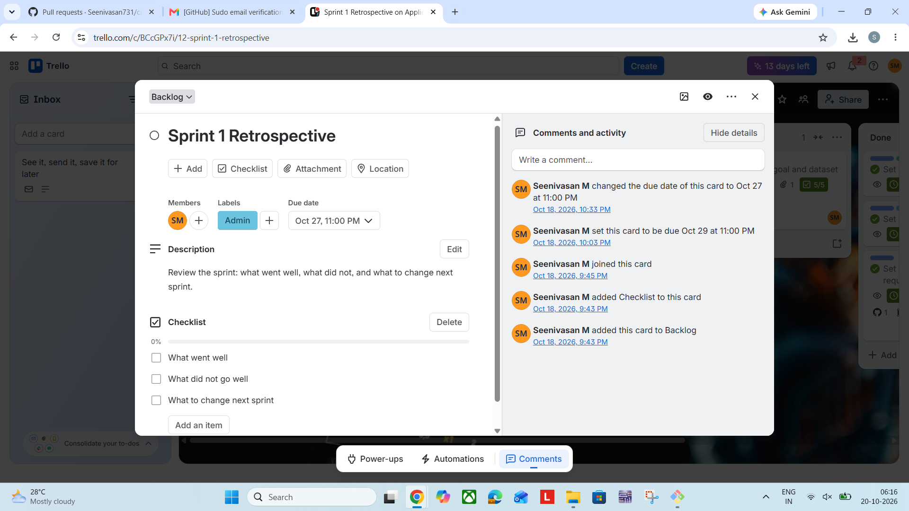

## Add vs Commit vs Push
- **Add:** moves chosen changes into the staging area. It selects what goes into the next snapshot.
- **Commit:** saves the staged snapshot in the **local** repository with a message and a unique ID.
  Nothing is on GitHub yet.
- **Push:** uploads local commits to the **remote** repository on GitHub, which backs them up and shares them.

Full discussion: [docs/add-commit-push.md](docs/add-commit-push.md)

## Pull Request History
| PR | Branch | Purpose | Trello card |
|---|---|---|---|
| #1 | `docs/project-plan` | Add project plan | Define project goal and dataset |
| #2 | `docs/project-plan-details` | Add goal, dataset, tools and milestones | Define project goal and dataset |
| #3 | `feature/environment` | Add Python requirements file | Set up Python environment and requirements.txt |
| #4 | `docs/readme` | Add README with setup and workflow | Write README.md |
| #5 | `docs/readme-full` | Expand README with screenshots, retrospective and future work | Write README.md |
| #6 | `docs/git-demo` | Add Git demo notes (video demonstration) | Demonstrate Git workflow |
| #7 | `feature/load-dataset` | Add CIFAR-10 dataset loader | Load dataset and display sample images |
| #8 | `feature/preprocessing` | Add data preprocessing (normalize, train/val split) | Preprocess data (normalise, train/test split) |
| #9 | `feature/baseline-model` | Add baseline CNN model architecture and training loop | Train baseline CNN model |
| #10 | `feature/evaluation` | Add model evaluation and confusion matrix generator | Evaluate model (accuracy, confusion matrix) |
| #11 | `feature/predict-own-photos` | Add web app for custom photo predictions | Predict on your own photos |
| #12 | `feature/augmentation` | Improve model with data augmentation | Improve model with data augmentation |

## Project Management (Trello)
- **Board:** https://trello.com/b/MbC8PuMr/applied-robotics-ai-project-task-management-for-cnn-image-classifier

**Lists:** Backlog, To Do, In Progress (WIP limit: 3), Review, Done.
The WIP limit is written in the list name.

**Labels**
| Label | Colour |
|---|---|
| Hardware | Orange |
| Software | Blue |
| AI / ML | Purple |
| Documentation | Green |
| Testing | Yellow |
| Bug | Red |
| Admin | Sky |

**Practices**
- Backlog holds planned work, To Do holds this week's tasks, In Progress never exceeds 3 cards.
- Every card has a label, a due date, a checklist and a member.
- The GitHub Power-Up links Pull Requests to cards; finished cards stay in Done with their PR link.
- One retrospective card per sprint.

## Sprint 0 Retrospective
Setup sprint, 17 to 19 Oct 2026.

**What went well**
- Trello board built with lists, labels, due dates and checklists.
- Every change reached `main` through a Pull Request, giving a clear history.
- Lecturer invited to both Trello and GitHub.

**What went wrong**
- PR #1's commit message did not match its content; fixed with a follow-up PR (#2).
- Windows blocked the `python` command (Store alias); the `py` launcher was used to create the virtual environment.
- Screenshots were saved with default names containing spaces, which break Markdown image links; they were renamed.
- Some screenshot names did not match their content and had to be corrected.

**What to change**
- Check each commit message against its content before committing.
- Name screenshots without spaces and by content as they are taken.
- Commit at least 3 times a week, on different days.
- Run `git status` before every `git add`.

## Future Work
| Dates | Task | Branch |
|---|---|---|
| 21 Oct | Load dataset and display sample images | `feature/load-dataset` (Merged PR #7) |
| 23 Oct | Preprocess data (normalise, train/test split) | `feature/preprocessing` (Merged PR #8) |
| 26 Oct | Train baseline CNN | `feature/baseline-model` (Merged PR #9) |
| 27 Oct | Sprint 1 retrospective | Trello card |
| 29 Oct | Evaluate model (accuracy, confusion matrix) | `feature/evaluation` (Merged PR #10) |
| 2 Nov | Predict on own photos | `feature/predict-own-photos` (Merged PR #11) |
| 3 Nov | Sprint 2 retrospective | Trello card |
| 6 Nov | Improve model with data augmentation | `feature/augmentation` (Merged PR #12) |
| 8 to 9 Nov | Final README update, cleanup, final retrospective | `docs/readme-final` |

## Author
Seenivasan, BEng (Hons) Robotics and Artificial Intelligence.
