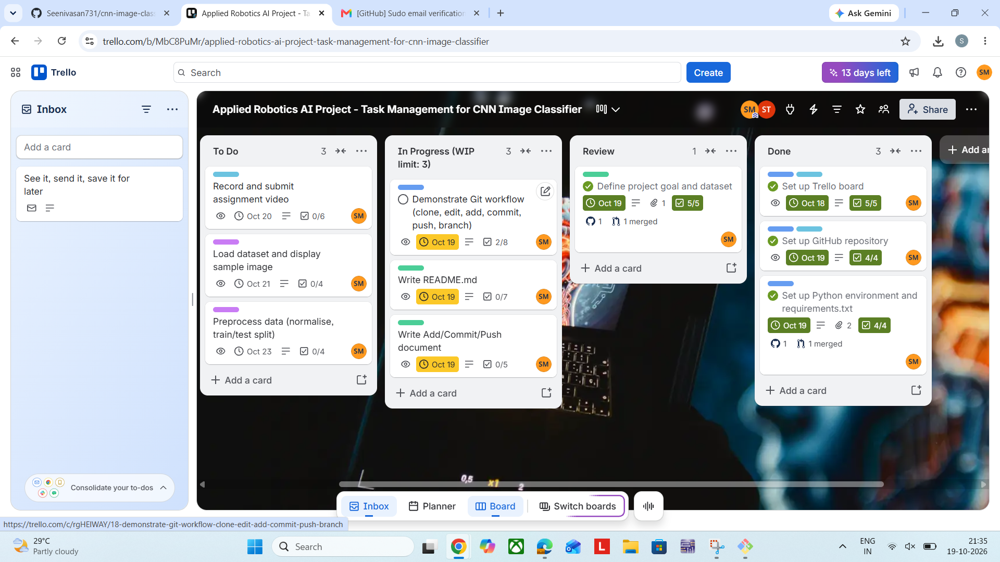
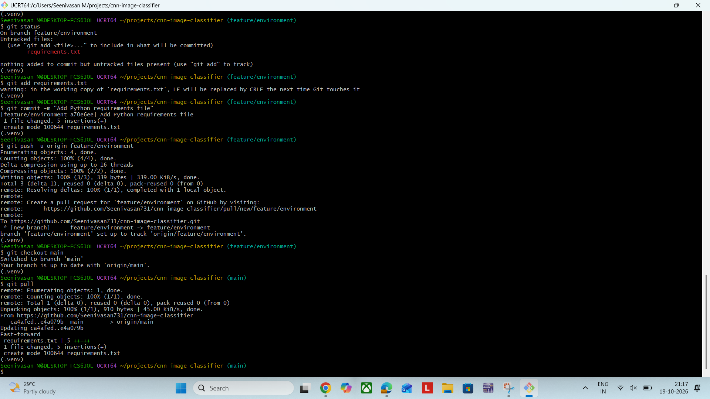

# CNN Image Classifier

A CNN that classifies CIFAR-10 images, built for robot vision in the
Applied Robotics and AI Project (University of Hertfordshire, PSB Academy).

## Setup
1. `git clone https://github.com/Seenivasan731/cnn-image-classifier.git`
2. `python -m venv .venv`, then `source .venv/Scripts/activate`
3. `pip install -r requirements.txt`

## Workflow
One Trello card -> one branch -> one Pull Request -> merge to main -> card to Done.
Trello board: https://trello.com/b/MbC8PuMr/applied-robotics-ai-project-task-management-for-cnn-image-classifier

## Branching strategy
- `main`: stable code only
- `feature/<name>`: new work
- `docs/<name>`: documentation
- `fix/<name>`: bug fixes

All branches are merged into `main` by Pull Request.

## Commit messages
Start with a verb (Add, Fix, Update) and keep under 50 characters.

## Key Git commands
| Command | Purpose |
|---|---|
| `git clone <url>` | Copy a remote repo to your machine |
| `git checkout -b <name>` | Create and switch to a branch |
| `git add <file>` | Stage changes |
| `git commit -m "msg"` | Save staged changes to the local repo |
| `git push -u origin <name>` | Upload commits to GitHub |
| `git pull` | Fetch and merge remote changes |

## Add vs Commit vs Push
- **Add** stages chosen changes for the next snapshot.
- **Commit** saves the staged snapshot in the local repo.
- **Push** uploads local commits to the remote repo on GitHub.

Full discussion: [docs/add-commit-push.md](docs/add-commit-push.md)